# Flash Games CE

TI-84 Plus CE ports of **Scouts vs Aliens** and **Pedro Kicks Back**.

The latest deliverable is the **v7 RAM and input preview**. [Download the calculator package](dist/FlashGamesCE-v7-preview.zip), check [its SHA-256](dist/FlashGamesCE-v7-preview.zip.sha256), and read [changes/limits](flash-ports/CONTINUATION-v7-2026-11-06.md) and [verification](flash-ports/verification/CHECKPOINT-v7.md). Pedro's running footprint including libraries drops from151,597 to107,871 bytes; it selects an optional exact sky cache or flash according to available RAM. Sampled free RAM is6,867 bytes with the cache,36,368 with an8KB filler selecting flash. Production FPS is40.0/21.15 stationary/moving with the cache,37.0/19.49 from flash. Scouts reaches80.33 ticks/sec at requested4x in quiet stage1, but only14.5 with25–29 enemies in stage16. All15/17 stage entries pass; full campaigns and physical hardware remain unverified. [Developer handoff](flash-ports/HANDOFF.md).

The original games and artwork are by Hamumu Software (2012). This repository tracks calculator port development and the supplied games' recovered reference material.

Both ports are native rebuilds written from the AS3 recovered with JPEXS: full-size original artwork, the original rules and formulas, enemy and tower behaviour, skill trees, conversations and scripted encounters. They are still works in progress. The [parity audit](flash-ports/PARITY-AUDIT.md) records what is checked by native tests, what is implemented but not yet verified in play, and what is not implemented. No percentage of parity is claimed.

Per-game notes, controls and known gaps: [flash-ports/scoutcamp](flash-ports/scoutcamp/README.md) and [flash-ports/pedrofu](flash-ports/pedrofu/PORT-NOTES.md).

## Development screenshots

Native calculator-emulator (CEmu) captures

Latest v7 production captures (counter benchmarks have no overlay):

| Pedro optional cache | Pedro flash fallback | Scouts crowded stage16 |
| --- | --- | --- |
| 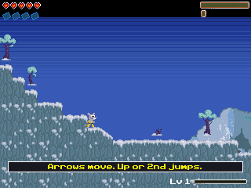 | 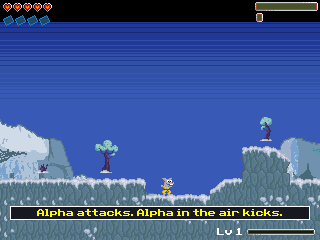 | 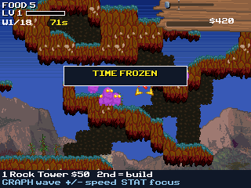 |

The crowded stage uses QA only to open the stage; its enemies spawn naturally. This is no campaign-win or unlock proof.

Earlier v5 production captures:

| Pedro kick instruction | Pedro arrow continuation | Scouts first-wave rapid input |
| --- | --- | --- |
| 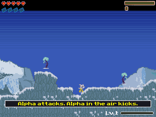 | 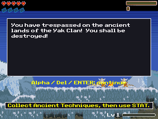 | 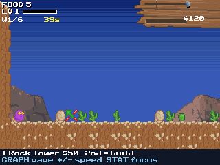 |

The Pedro continuation capture shows the first Yak conversation, not a completed stage or a hardware crash fix.

Latest v4 captures (Pedro's skill screen is from the native UI test harness):

| Scouts campaign map | Pedro skill details | Scouts speed controls |
| --- | --- | --- |
| 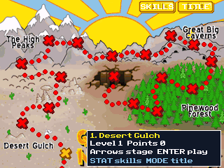 | 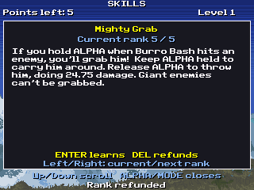 | 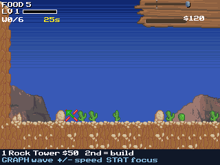 |

Earlier v3 production checkpoint:

| Pedro opening | Pedro aerial-kick tutorial | Scouts |
| --- | --- | --- |
| 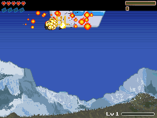 | 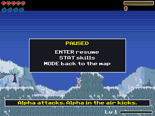 | 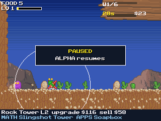 |

| Scouts vs Aliens | Pedro Kicks Back |
| --- | --- |
|  |  |
|  |  |
|  |  |

## Build environment

The project uses the [CE C/C++ toolchain](https://github.com/CE-Programming/toolchain), GraphX, keypadc and fileioc. Makefiles expect a workspace-local portable toolchain at `local-tools/cedev/CEdev` and game projects under `flash-ports/`. Asset converters require Python 3.12 with Pillow. Each program needs its resource AppVars alongside it (`SCAxx` for Scouts, `PDxxx` for Pedro); `flash-ports/package.py` assembles the transfer package.

## Credits

Scouts vs Aliens and Pedro Kicks Back were created by Hamumu Software (copyright 2012, [hamumu.com](http://hamumu.com)); the original music is by Nosoapradio.us. This is an unofficial fan project and grants no rights to the original games, artwork or music. See [flash-ports/CREDITS.md](flash-ports/CREDITS.md) for the full list, including the tools used.
