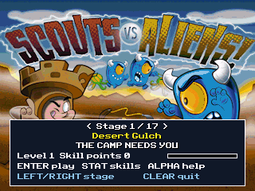
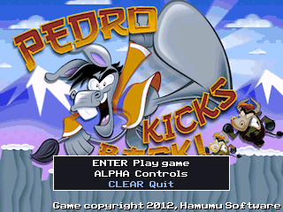
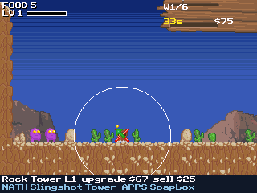
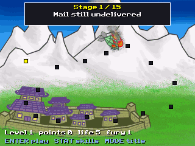
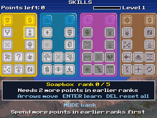
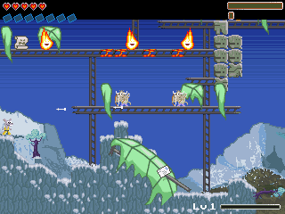

# Flash Games CE

TI-84 Plus CE ports of **Scouts vs Aliens** and **Pedro Kicks Back**.

Project owner and contributor: [Jonathan Trapp (@jonathantrapp)](https://github.com/jonathantrapp).
The original games and artwork are by Hamumu Software (2012). This private repository tracks calculator port development and the supplied games' recovered reference material.

Both ports are native rebuilds written from the AS3 recovered with JPEXS: full-size original artwork, the original rules and formulas, enemy and tower behaviour, skill trees, conversations and scripted encounters. They are still works in progress. The [parity audit](flash-ports/PARITY-AUDIT.md) records what is checked by native tests, what is implemented but not yet verified in play, and what is not implemented. No percentage of parity is claimed.

Per-game notes, controls and known gaps: [flash-ports/scoutcamp](flash-ports/scoutcamp/README.md) and [flash-ports/pedrofu](flash-ports/pedrofu/PORT-NOTES.md).

## Development screenshots

Native calculator-emulator captures (CEmu with a user-supplied ROM), not browser mockups.

| Scouts vs Aliens | Pedro Kicks Back |
| --- | --- |
|  |  |
|  |  |
|  |  |

## Build environment

The project uses the [CE C/C++ toolchain](https://github.com/CE-Programming/toolchain), GraphX, keypadc and fileioc. Makefiles expect a workspace-local portable toolchain at `local-tools/cedev/CEdev` and game projects under `flash-ports/`. Asset converters require Python 3.12 with Pillow. Each program needs its resource AppVars alongside it (`SCAxx` for Scouts, `PDxxx` for Pedro); `flash-ports/package.py` assembles the transfer package.

Verification uses CEmu with a user-supplied calculator ROM (`flash-ports/run_scenario.py`, `verify_stages.py`) and host-side checks that run the real native rules code against values evaluated from the original AS3. ROMs, authentication data, generated AppVars and unrelated workspace projects are excluded from this repository. Original-runtime comparison uses the official Ruffle web package locally.
