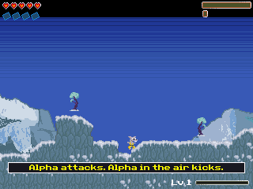
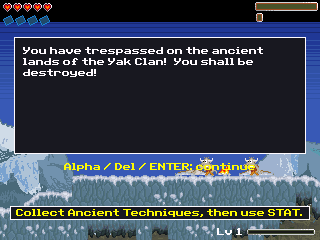

# v5 verification, 6 November 2026

This continues v4 commit `db136ad`. All emulator results use the local OS 5.3.0.0037 ROM at a reported 48 MHz CPU clock. They do not reproduce the user's revision-8 / OS-5.8.2.29 / ROM-5.6.1.6 / arTIfiCE launch environment.

| Production program | Bytes | SHA-256 |
| --- | ---: | --- |
| PEDROCE.8xp | 58,689 | `d1e5b5c667a54655fa5b32afd276cad8e4790be990a883f541e7daf318c0d958` |
| SCOUTCE.8xp | 46,974 | `9a64c9ef1f85b452c2e40396aaf6b3378ae737dc8fbdec2f0e0be94f4c3faa74` |

## Pedro performance and memory

The only production rendering change is the bounded actor cache: six 1,600-byte slots (9,600 bytes total), replacing eight 1,024-byte slots (8,192 bytes). Original 23×38 trees and 25×30 hit sparks now fit the conservative GraphX conversion bound. Large sprites still use the existing fallback. No art, map, collision, damage or simulation rule changed.

The same diagnostic script used for v4 records 13 rendered FPS / 30 simulation steps per second; v4 recorded 12 / 30. Simulation occupied 120 ms and drawing 654 ms in the sampled epoch. The latest actor/prop phase took 204 timer ticks (6.2 ms), versus 299 (9.1 ms) in v4. These are individual diagnostic samples, not a sustained minimum, frame-for-frame scene comparison or hardware result. The profile build skips the opening through its existing diagnostic entry path and adds an overlay. Production has neither behavior.

[Performance counters](pedrofu/v5_actor_trial/performance.json) identify both profile and production binary hashes. A trial replacing sky rectangles with contiguous fills stayed at 12 FPS and was rejected; its counters remain in `pedrofu/v5_sky_trial/performance.json`. Production retains the v4 sky renderer.

Pedro's resident end is `0xD365D8`; BSS ends at `0xD12903`, leaving 5,845 bytes before the configured allocator limit `0xD13FD8`. The linker still rejects resident code/data above `0xD40000`. This bound and the buffer tests below do not identify the cause of a physical RAM clear.

`pedrofu/tests/check_native_render_cache.py` compares actual cache draws with GraphX transparent-sprite reference draws. It covers all 296 terrain indices under 15 stage selections, four edge montages, eight clipped HUD montages and ten actor/eviction montages in both facings and at screen edges. Separate 64-byte canaries surround each actor slot and the tile/HUD arrays. See the fixture's `result.json` and `smoke.log`; a result-screen-ready check waits for the final framebuffer swap before screenshot capture. These are native-renderer checks, not comparisons with Flash screenshots.

The fixture's captured LCD image remains blank despite its completed swap/status flags. Treat the fixture's memory comparisons and canaries as automated evidence; its image does not visually verify a result screen. The production screenshots below come from separate game runs and show the tutorial and dialogue.

## RAM-clear report and arrow-input runs

The user's clarification was: after the kick instruction, arrow keys, launched through arTIfiCE. `v5_arrow_tutorial` visibly shows “Alpha attacks. Alpha in the air kicks.” `v5_arrow_continuation` continues with arrow input to the first Yak conversation. Both production scenarios passed their state checks without an emulator NMI. `v5_postkick_arrows` reaches the kick-instruction area and pauses after mixed arrow input; the earlier `v5_kick_tip` and `v5_kick_instruction` names are only approach captures and do not themselves show the kick instruction.

| Kick instruction reached | Continued to Yak conversation |
| --- | --- |
|  |  |

The scenarios use normal production entry with the opening enabled. Their logs/configurations retain the exact key sequence locally; selected logs and run metadata accompany the repository. No crash was reproduced in this environment, and no physical fix is established. The upstream [v2.1 source example](https://github.com/YvanTT/arTIfiCE/blob/v2.1/src/CabriJmp.asm) explicitly omits the actual shell implementation, so reading that example cannot establish launcher equivalence.

## Scouts input and measured speed

Scouts samples transitions into a 16-entry FIFO during rendering and between simulation steps, then handles queued states in order. Polling targets roughly 125 Hz; slow rendering/simulation can still increase gaps. Cursor repeat uses a 200 ms timer independently of frame rate. This is a keypad adaptation; the simulation engine and original art/data remain unchanged.

`scoutcamp/tests/check_input_timing.py` ran fresh production captures, recorded in [input-timing-results.json](../scoutcamp/tests/input-timing-results.json). Nine plus taps at 220/150, 80/80 and 40/40 ms hold/release intervals all reached 12 thirds, including the freeze/restore sequence. The paired frozen runs retained tick 6 after 0.5 and 6.5 seconds. No input FIFO overflow occurred. Worst recorded polling gaps across entire runs, including menus/stage loading, reached about 114 ms; these tests do not guarantee that every 40 ms tap will be detected at arbitrary phases or loads.

| Requested speed | Tick difference over 6 emulated seconds | Measured ticks/sec | Requested ticks/sec |
| --- | ---: | ---: | ---: |
| 1× | 119 | 19.83 | 20 |
| 4× | 269 | 44.83 | 80 |

Each rate subtracts otherwise identical 1-second and 7-second active intervals, both frozen before capture. This removes shared launch/control overhead better than the older single-interval estimate; frame-boundary sampling still contributes error. The test has not proved sustained 4× speed. An initial near-1 kHz polling variant measured only 26 ticks/sec at the fast setting; the retained `input-timing-poll1-results.json` describes that rejected configuration, not the packaged program.

Scouts' resident end is `0xD2E971`; BSS ends at `0xD136B8`, leaving 2,336 allocator bytes. Resource validation passed all 33 SCA banks, 1,035 frame bounds, 240 skill descriptions and 153,600 decoded sky pixels. Bundle signature remains `91bdb3a8`.

`v5_combat_rapid40` and `v5_combat_rapid80` also passed three assertions each: still in gameplay, first wave sent, and all nine plus taps reaching 12 thirds after freeze/restore. They use 40/40 and 80/80 ms hold/release intervals after GRAPH and a 1.5-second wait. [First-wave screenshot](../../docs/screenshots/scout-v5-rapid.png).

## Campaign and package limits

The new stage-entry matrix is `STAGE-SMOKE-v5-pedrofu-scoutcamp.md`. It tests entry and short gameplay/dialogue/result states, not winning a stage. Scouts stages 1–3 were repeated after the final polling-throttle build; their fresh metadata identifies the packaged hash. Other Scouts entries started after that final build. Earlier v4 tests remain historical evidence for unchanged code, not new tests of this package.

Full original-versus-port playthroughs remain unfinished, including bosses, arenas, every skill interaction, endings reached through play and save reload under archive pressure. Computer Use stopped the original-game browser attempt because it could not verify Brave's URL; browser control was also disabled in Work settings. No campaign-completion or original-fidelity claim follows from the smoke matrix.

The v5 ZIP contains two programs, 61 game-data AppVars and four runtime AppVars, plus instructions, credits, this report and the SHA-256 manifest. Packaging verifies resident-memory bounds, expected resource names/counts and ZIP integrity. No ROM, raw RAM dump, diagnostic build or unrelated NeuroFlappy file belongs in this package.
