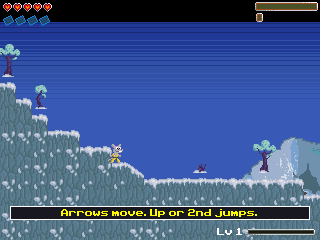
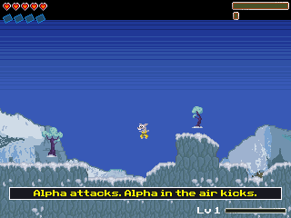

# v6 performance verification, 6 November 2026

Continues `82632bd`. All timing below comes from CEmu with the local OS 5.3.0.0037 ROM and a reported 48 MHz CPU clock. The user's physical revision-8 calculator runs OS 5.8.2.29 / ROM 5.6.1.6 through arTIfiCE; that environment remains untested.

| Packaged program | Bytes | SHA-256 |
| --- | ---: | --- |
| PEDROCE.8xp | 60,826 | `be1a601f9859941f0492af6a033349355c5c953ffc64ad0c82aba4b51a7e5f35` |
| SCOUTCE.8xp, unchanged from v5 | 46,974 | `9a64c9ef1f85b452c2e40396aaf6b3378ae737dc8fbdec2f0e0be94f4c3faa74` |

## Frame-rate measurements

The old 13 FPS sample included diagnostic text drawn every frame. That overlay materially lowered throughput. v6 separates display wait from drawing, makes the overlay opt-in, and records cumulative counters so matched intervals can be subtracted. Do not describe the whole 13-to-40 difference as an optimization gain.

| Comparable diagnostic-entry builds, no overlay | Stationary camera | Movement/jump sequence |
| --- | ---: | ---: |
| v5 renderer with timing instrumentation | 17.33 FPS | 16.67 FPS |
| Corrected v6 renderer with timing instrumentation | 37.50 FPS | 20.77 FPS |

The baseline and v6 diagnostic runs use the same stage-one entry script, skipping the opening through the existing QA path. Each result identifies its actual test-program hash. See `pedrofu/v6_baseline_pair-benchmark.json`, `v6_baseline_motion-benchmark.json`, `v6_final_pair-benchmark.json` and `v6_final_motion-benchmark.json`.

The packaged binary has separate normal-opening measurements in `pedrofu/v6_final_production_pair-benchmark.json` and `pedrofu/v6_final_production_motion-benchmark.json`. Their individual captures and metadata identify the packaged hash above. These normal-opening results are additional production measurements, not identical starting positions to the diagnostic-entry comparison.

| Final packaged binary, normal opening | FPS | Simulation steps/sec |
| --- | ---: | ---: |
| Stationary-camera interval | 40.00 | 30.00 |
| Movement/jump interval | 21.79 | 29.87 |

Idle rates subtract matched 4-second and 10-second active intervals. Movement rates subtract 3 and 9 right/left cycles while holding jump after four seconds moving right; each cycle lasts 1.3 seconds including releases, yielding a 7.8-second difference. Shared startup/control overhead cancels, but frame-boundary sampling still contributes error. The scripts assert PLAY at capture. `benchmark_frames.py --production-entry` runs the normal opening; no timing overlay appears in the package.

The 20 FPS milestone is reached in these movement tests, and the stationary scene exceeds 30 FPS. Sustained 30 FPS scrolling and 60 FPS gameplay are not established. Camera movement forces full background redraws; that remains the main rendering target.

## Exact-pixel rendering changes

`build_row_sky.py` reconstructs all 76,800 original sky pixels exactly, SHA-256 `69cd84560bba62773feb180a622692548b5fbddc08295abe425646bf116bbeef`. It stores 120 nonuniform rows in a 37,679-byte overlapping row stream with 720 metadata bytes. Each referenced row remains a contiguous 320-byte slice, so drawing requires no runtime decompression. Uniform rows use fills. The artwork and palette are unchanged.

Sky rendering omits the covered 22-pixel HUD strip and conservatively covered bottom rows. Opaque-tile flags provide the proof of terrain coverage; unknown/transparent tiles never authorize culling. The notice cache stores the exact panel pixels and regenerates for changed text/colors; overlong text takes the original drawing path.

Each framebuffer has its own bounded repair list and visible-terrain/scenery snapshot. A stable camera permits background restoration beneath old dynamic sprites. Full redraw handles scrolling, terrain/scenery changes, stage/frontend transitions and overflow. Expired notices, mail icons below the HUD, changing health/fury/XP, frozen/flattened enemies and foreground decoration retain their original layering.

`check_native_scene_render.py` passed **600 whole-frame comparisons** against `tests/reference/render_v5.c`, with zero pixel differences and zero notice/scene-cache canary damage. Its final counters show 552 full redraws, 48 reused backgrounds and 12 repair-overflow fallbacks. The fixture exercises both framebuffer addresses in separate sequences, 15 original maps, changed pickups/terrain, 96-enemy damage-list pressure, a 25-to-24 scenery transition and overlong notices. Intro is stubbed off and the states are synthetic; this is not a gameplay or Flash comparison. See [the fixture result](../pedrofu/tests/scene-native/result.json) and [log](../pedrofu/tests/scene-native/smoke.log).

The native tile/HUD/actor cache fixture also passed its all-stage tile selections, edge/clip montages and canaries. Its result-image limitation from v5 remains; automated memory comparisons supply the evidence, while separate production screenshots show gameplay.

The expanded fixture initially exposed old mail-icon pixels below the black HUD. Debug capture localized the difference to row 22. Cleanup now uses the actual mail row/width; scenery changes and overflow also invalidate reuse. Earlier failed results are development evidence, not release passes.

## Memory, production checks and limits

Pedro's resident end is `0xD3C65C`, leaving 14,756 bytes before the LCD framebuffer boundary `0xD40000`. BSS ends at `0xD13011`, leaving 4,039 allocator bytes. The linker guard remains enabled. The new notice images occupy guarded resident storage rather than consuming the remaining allocator region.

A clip-query HUD experiment did not improve FPS and was removed. The assembly/row-pointer sky experiment stopped with an OS MEMORY error before gameplay; no useful timing followed, and that experiment is excluded from `src/` and the package. This is why the production checks use the selected C build rather than a theoretical faster path.

Final stage-entry results: `STAGE-SMOKE-v6_final-pedrofu.md`. These checks assert all 15 selected stages and short gameplay/dialogue/result states. They do not prove any stage can be won. Scouts' v5 entry/input evidence applies to its unchanged binary.

Additional production captures retain the opening, arrow tutorial, pause/skills/details/map transitions, input stress and observed OS return. Their metadata distinguishes the immediately preceding candidate from the final overflow-sentinel build; only captures carrying the packaged hash are final-binary evidence. None proves a campaign, an archive-pressure save/reload, hardware stability or resolution of the reported physical RAM clear.

| Production stationary scene | Production movement scene |
| --- | --- |
|  |  |

The preview ZIP contains two programs, 61 unchanged game-data AppVars, four runtime AppVars, credits, controls, this report and a per-file manifest. Packaging verifies resource names/counts, resident bounds, hashes and ZIP integrity. No ROM, raw RAM or experimental program belongs in the package.
